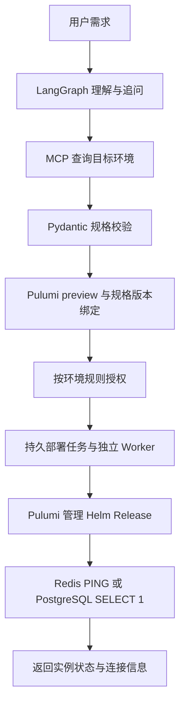

# Agent 框架比较研究

研究日期：2026-09-10。项目基线：后端 `c275f16`。这是针对当前需求的选型研究，不表示已经接入本文列出的框架或完成真实集群部署。后端开发约定仍以 [README](../README.md) 为准。

## 需求与判断标准

本轮目标是在已有 POC Kubernetes 集群中开通单实例 Redis/PostgreSQL，默认持久卷与集群内访问。已有 Python/FastAPI、React、PostgreSQL 和 Pulumi Automation API 基础；计划通过受控模板和 Helm Release 完成资源管理。用户提到的 `dsh`、`cdh` 全名尚未确认，不能把它们自行等同于某个 SDK、产品或框架。

这个范围的主要难点是准确提取参数、查询集群事实、明确流程状态、处理缺失参数和执行失败。比较应优先关注这些能力，以及持久恢复、模型网关适配、现有项目的改造量。多智能体协作、任意代码执行、文件系统工具是否丰富，暂时不构成主要选型依据。

## 当前工程已有什么

以下事实来自本地代码和项目验证记录，本次研究没有重新运行测试。

| 部分 | 已实现 | 当前边界 |
| --- | --- | --- |
| 工作流 | `StateGraph`：`understand → validate → clarify`，缺参时 `interrupt()`，补充后继续分析 | 完整参数只产生 `ready` 方案，尚无集群查询、预览、授权或部署节点 |
| 持久化 | 官方 `AsyncPostgresSaver`，独立 `agent_graph` schema，`durability="sync"` | checkpoint 与业务任务表分开；它们不是一个覆盖外部调用的原子事务 |
| 业务任务 | `agent_tasks`、`agent_turns`，请求幂等、revision、行锁领取轮次、失败重试 | 消费者在应用进程内，分析期间持有有界长事务；部署任务调度仍需设计 |
| 模型 | `Extractor` 协议隔离模型；`CompatibleModel` 直接使用 OpenAI 兼容 Chat Completions 接口，Pydantic 校验输出 | 未接入 LangChain 的完整 Agent 循环；实际模型理解质量与网关联通尚未验收 |
| Pulumi | 固定 CLI/SDK、隔离 Worker 和常量程序生命周期自测 | 未接 Kubernetes Provider、Helm 模板、稳定业务 Stack 或生产 state backend |

源码依据：[workflow.py](../app/agents/workflow.py)、[runtime.py](../app/agents/runtime.py)、[model.py](../app/agents/model.py)、[Agent Worker](../app/workers/agent.py)。锁定版本为 LangGraph **1.2.11**、PostgreSQL checkpointer **3.1.2**、OpenAI SDK **2.54.0**，见 [uv.lock](../uv.lock)。

[现有集成文档](langgraph.md) 和 [todo](../todo.md) 记录本轮 88 个测试通过、6 个跳过，真实模型、POC 集群和新增 PostgreSQL checkpoint/并发集成测试尚未完成实际环境验收。这是历史验证记录，不能解释为本研究重新验证通过。

## LangGraph、LangChain 与 Deep Agents 的关系

| 项目 | 主要职责 | 对当前需求的意义 |
| --- | --- | --- |
| LangGraph | 底层有状态编排运行时：图节点、分支、持久恢复、中断、流式输出 | 可明确控制需求分析、查询、预览、执行、验证的顺序 |
| LangChain | 模型与工具抽象，以及预构建 Agent 循环 | 当需要统一更多模型或工具调用时可按需引入 |
| Deep Agents | 基于 LangChain 组件和 LangGraph 运行时的 Agent harness，增加上下文管理、文件工具、子智能体等 | 更适合任务路径不固定、需要研究文件或自主分解问题的场景 |

它们具有分层关系，不能把三者当成完全互斥的同类产品。LangGraph 官方明确说明，使用 LangGraph 不要求应用采用 LangChain 的高层模型和 Agent API；本项目直接调用兼容模型接口就是一种可行用法。来源：[LangGraph overview](https://docs.langchain.com/oss/python/langgraph/overview)、[Deep Agents overview](https://docs.langchain.com/oss/python/deepagents/overview)。

## LangGraph 核实结果与取舍

**持久状态与人工输入。** 配置数据库 checkpointer 和稳定 `thread_id` 后，可以保存进度并在稍后恢复。`interrupt()` 用于等待补充参数或外部决策，同一线程通过 `Command(resume=...)` 继续。中断恢复会从所在节点开始重新执行，中断之前的代码也会重跑。当前项目将模型调用与等待输入分为不同节点，符合这个恢复边界。来源：[Checkpointers](https://docs.langchain.com/oss/python/langgraph/checkpointers)、[Interrupts](https://docs.langchain.com/oss/python/langgraph/interrupts)。

**外部副作用不会自动恰好执行一次。** 即使已保存 checkpoint，尚未完成并保存结果的任务仍可能重跑。官方要求对外部写操作使用幂等键或核对已有结果。因此未来 Pulumi 执行仍需要稳定 Stack 身份、任务幂等、同 Stack 串行执行，以及异常后核对 state 和实际资源。框架恢复不等于 Kubernetes 事务，也不意味着自动回滚。来源：[Functional API：Idempotency](https://docs.langchain.com/oss/python/langgraph/functional-api#idempotency)，项目约束见 [README](../README.md)。

**模型选择不受图引擎绑定。** 节点可以调用普通 Python 函数、自定义客户端或不同供应商的模型适配。框架兼容不代表模型拥有相同的结构化输出、工具调用和指令遵循效果；真实网关还需针对部署需求验收。来源：[LangGraph overview](https://docs.langchain.com/oss/python/langgraph/overview)，本地适配证据为 [model.py](../app/agents/model.py)。

**MCP 可作为查询适配接入。** LangGraph 节点可以调用封装好的客户端，或采用 LangChain 的 MCP 工具适配。今天打开的官方文档显示 `langchain.mcp.MCPAdapter` 基于 FastMCP，要求 `langchain[mcp]>=1.4.0` 且仍为 beta；搜索结果中仍能看到旧 `langchain-mcp-adapters` API。当前仓库尚未选择或安装这些接口，下一步应独立确定客户端版本、认证与超时，不应因阅读新文档就连带升级整个 Agent 栈。来源：[LangChain MCP](https://docs.langchain.com/oss/python/langchain/mcp)。

**本项目适配判断。** 固定服务模板的开通步骤可以由显式节点和普通 Python 业务代码实现，模型主要用于理解需求与解释结果。LangGraph 的价值是把多轮输入、状态分支和恢复机制放在一个已验证过的编排层。代价是需要维护图状态、checkpoint 生命周期，以及业务表与图状态的同步；对只有一次模型提取加一个同步 API 的极小演示来说，普通 Python 服务会更轻。

继续使用它仍有工作要做：完成 MCP 与真实集群校验、部署任务生命周期、资源模板、Pulumi 状态管理及执行结果验证。LangGraph 并不会提供这些业务实现。

## Deep Agents 核实结果与取舍

官方框架提供文件系统工具、上下文压缩与转存、子智能体以及基于 LangGraph 的中断机制，并可接多种模型和 MCP 工具。当前文档的任务清单规划为可选能力，不能假定所有版本都默认启用。来源：[Deep Agents overview](https://docs.langchain.com/oss/python/deepagents/overview)。

**本项目适配判断：当前不必作为主流程入口。** “选择 Redis/PostgreSQL 模板、填写参数、部署、验证”的步骤明确；文件探索、自主拆分和多智能体执行暂时不能明显减少必须开发的部署管理代码。引入 Deep Agents 还需定义可见工具、会话状态映射、模型配置与上下文保留策略，并重新验证失败恢复和前端对话契约。

后续如果增加“读取项目仓库推断部署方式”“分析多组件故障”“研究并提出修复方案”，可以把它作为独立研究或诊断模块，再将结构化结论交回现有编排。使用相同 LangGraph 底座不意味着现有 checkpoint 格式可以直接迁移；仍需处理状态 schema 与运行版本兼容。

## 其他候选的官方能力与适配判断

以下评价针对本项目，不是框架通用排名，也不是性能、成本或模型准确率实测。表中“备选”不代表框架缺少部署能力，而是指替换当前实现尚无足够收益。

| 候选 | 主要价值 | 当前取舍 |
| --- | --- | --- |
| LangGraph | 显式图、持久 checkpoint、人工输入与恢复，能调用普通 Python 模块 | 首选保留，现有实现已覆盖规划和追问 |
| Pydantic AI | 类型化输入输出、依赖注入、工具、模型适配和 deferred tools | 从零构建轻量参数分析服务时值得优先试；本项目作为备选 |
| OpenAI Agents SDK | Agent 循环、工具、handoff、MCP、会话、审批状态和 tracing | 工具调用助手可选；当前迁移仍需改造 runtime 与持久状态 |
| Google ADK | Agent 与图工作流、结构化输出、MCP、人工输入及配套运行体系 | 有 Google 生态或 ADK 工作流需求时评估；可自托管，不强制 Google Cloud |
| Microsoft Agent Framework | Agent 与工作流、checkpoint、MCP、多模型 | Microsoft/.NET/Foundry 体系可优先评估；当前 PostgreSQL 存储需要适配 |
| Dify | 可视化 Workflow/Chatflow、Agent、模型与工具管理、Human Input | 适合流程维护人员需要可视化编辑；现有平台需增加部署和身份/任务映射 |
| CrewAI | 多角色协作，以及有状态、事件驱动的 Flows | 当前固定开通步骤收益有限，另有 Python 版本冲突 |
| Claude Agent SDK | 文件与命令工具、权限、MCP、结构化输出和会话恢复 | 以后用于仓库分析、IaC 修改或排障；不优先替换固定部署主流程 |
| Deep Agents | 通用 harness、上下文管理、文件工具和子智能体 | 以后用于需要自主探索的任务，可保留 LangGraph 主流程 |

### Pydantic AI

官方提供 Pydantic 输出、类型化工具、依赖注入、MCP 和多模型适配。Deferred tools 可暂停等待人工决定或外部工具结果，再继续运行。框架文档中的 durable execution 则接入 Temporal、DBOS、Prefect 等独立引擎；持久任务运行需要部署对应引擎或由应用自行负责，不能把聊天历史保存等同于可靠队列和副作用去重。[概览](https://pydantic.dev/docs/ai/overview/)、[Deferred tools](https://pydantic.dev/docs/ai/tools-toolsets/deferred-tools/)、[Durable execution](https://pydantic.dev/docs/ai/capabilities/durable_execution/overview/)。

本项目已有 Pydantic schema 和模型 `Extractor`。仅为了结构化输出迁移框架，不能减少部署任务和 Pulumi 管理代码；若未来明确缩小为短流程、少工具服务，可在独立验证中比较代码复杂度和真实模型输出质量。Pydantic 校验库与 Pydantic AI 是不同依赖，当前项目仅使用前者。

### OpenAI Agents SDK

官方 SDK 支持工具调用和 handoff；会话可保存历史，审批中断提供 `interruptions` 和 Python `to_state()`，可以序列化后在后续请求恢复。因此不能评价为“没有持久化或人工确认”。任务记录、审批状态落库、队列调度、外部资源幂等仍是本平台要接入的职责。[Orchestration](https://developers.openai.com/api/docs/guides/agents/orchestration)、[Results and state](https://developers.openai.com/api/docs/guides/agents/results)。

MCP 支持 SDK 管理的本地/私有 stdio 或 Streamable HTTP 连接，也有托管 MCP 方式；本项目的内部查询适合由自己的 Worker 建立连接。官方允许非 OpenAI 模型的 provider/adapter，不能描述为只支持 OpenAI；但部分高级能力依赖 Responses 路径，兼容网关要逐项验证。[MCP 与 tracing](https://developers.openai.com/api/docs/guides/agents/integrations-observability)、[Models and providers](https://developers.openai.com/api/docs/guides/agents/models)。

当前 `openai` 包是模型 API SDK，不等于已经安装 `openai-agents`。本项目若迁移，需要保持现有任务 API、用户隔离、状态持久化和重试契约；对已实现的固定步骤图，没有发现足够收益。

### Google ADK 与 Microsoft Agent Framework

ADK 当前官方文档包含 2.0 图工作流、`RequestInput` 人工输入和结构化 schema；不能只按旧印象理解为顺序/并行/循环 Agent。`output_schema` 与工具同请求组合仍取决于模型支持。Resume 文档说明工具可能至少执行一次，恢复时可再次调用，因此资源变更仍需业务幂等。[结构化输出](https://adk.dev/agents/llm-agents/#structure-data-input-and-output)、[图人工输入](https://adk.dev/graphs/human-input/)、[Resume](https://adk.dev/runtime/resume/)。

Microsoft 官方将 Agent Framework 定位为 AutoGen 与 Semantic Kernel 的直接后继，提供 Agent、MCP、多模型、显式工作流和 checkpoint。新选型应以 Agent Framework 为主评估，不把三者当成同一时间的三条独立首选路线。官方列出的 checkpoint 实现包含内存、文件、Cosmos DB；接入现有 PostgreSQL 需要实现存储协议。[Overview](https://learn.microsoft.com/en-us/agent-framework/overview/)、[Workflows](https://learn.microsoft.com/en-us/agent-framework/concepts/workflows/)、[Checkpoint storage](https://learn.microsoft.com/en-us/agent-framework/workflows/checkpoints)。

两个框架都可承载本项目；现有 FastAPI、PostgreSQL 和 LangGraph 流程已经落地，迁移应由明确生态依赖或原框架无法满足的需求驱动。

### Dify 与 CrewAI

Dify 提供可视化应用平台，也支持从外部前端通过 API 使用；Human Input 节点支持暂停后提交输入继续，工具支持 HTTP MCP。因此其适配问题是额外平台运维、账号权限映射和任务状态关联，而非缺少 MCP 或人工输入。需要非开发人员编辑流程和提示词时，可重新评估。[Human Input](https://docs.dify.ai/en/cloud/use-dify/nodes/human-input)、[Tools](https://docs.dify.ai/en/cloud/use-dify/workspace/tools)、[Self-host](https://docs.dify.ai/en/self-host/deploy/quick-start/docker-compose)。

CrewAI 不只有多角色协作：Flows 支持路由、状态、持久化与恢复，人工反馈可以异步继续。但本项目当前只需要明确的开通步骤，迁移不会消除数据库、部署任务与 Pulumi state 的维护。研究日官方安装要求为 **Python >=3.10,<3.14**，与本项目 CPython 3.14 冲突；引入前需调整运行环境或拆分服务，并重新验证依赖。[Flows](https://docs.crewai.com/en/concepts/flows)、[Human feedback](https://docs.crewai.com/en/learn/human-feedback-in-flows)、[Installation](https://docs.crewai.com/en/installation)。

### Claude Agent SDK

SDK 将 Claude 的 Agent 循环和文件、命令等工具嵌入应用，支持 MCP、JSON Schema/Pydantic 输出及权限控制；会话恢复也可使用外部 `SessionStore`，不能描述为只能保存本地文件。Hosting 文档说明运行涉及 CLI 子进程、工作目录和会话存储；这些运行条件需要单独设计。[Hosting](https://code.claude.com/docs/en/agent-sdk/hosting)、[Structured outputs](https://code.claude.com/docs/en/agent-sdk/structured-outputs)、[Permissions](https://code.claude.com/docs/en/agent-sdk/permissions)。

它可通过多个服务渠道接入 Claude，仍主要面向 Claude 模型生态。[Quickstart](https://code.claude.com/docs/en/agent-sdk/quickstart)。对于以后读取仓库、生成 IaC 补丁、解释日志和提出修复方案很有价值；当前固定 Redis/PostgreSQL 模板部署优先使用明确参数与普通业务接口。会话恢复不负责保证资源操作只执行一次。

## 建议与迁移成本

针对当前范围，**建议保留 LangGraph 主流程，Pydantic AI 作为轻量备选**。显式步骤、持久多轮状态与现有受控执行模式匹配，已有代码也实现了相关恢复行为。迁移成本只是因素之一；如果从零开始且只做短流程，普通 Python + 模型 SDK 或 Pydantic AI 也可以合理满足需求。

| 方向 | 需要保留或改变的内容 | 主要成本 |
| --- | --- | --- |
| 保留 LangGraph | 保留模型 `Extractor`、业务表与前端契约，补充查询和执行用例 | 主要成本集中在真实部署业务闭环 |
| 直接使用普通 Python + 模型 SDK | 保留 schema、业务表、鉴权和 Pulumi 适配，自行维护追问与恢复 | 减少框架抽象，但需要替换当前图状态和 checkpoint 恢复机制 |
| 在局部引入 Deep Agents | 保留主流程，为自主研究或诊断增加独立入口 | 新工具表面、上下文策略、模型调用成本和行为评估 |
| 全面替换主 Agent 框架 | 前端 API 可尽量保持，迁移 Agent runtime、暂停恢复和持久状态 | 迁移进行中的会话，重新验证重试、并发与异常恢复；不会省掉 Pulumi/K8s 集成 |

建议按下面的职责继续设计，并在业务范围明确后实现：

LangGraph checkpoint 管流程进度，业务表管用户归属、任务和授权，Pulumi state 管资源映射。三者有不同事务边界；重试必须先核对执行结果，不能仅靠恢复图节点防止重复创建服务。长时间 Helm/Pulumi 操作应由独立部署 Worker 处理，不能直接延长当前分析消费者持有的数据库事务。

## 未决项与验证范围

- `dsh`、`cdh` 全名或链接待用户确认；本次不猜测它们代表哪一个框架。
- 官方文档按访问日记录，新 API 不自动适用于项目锁定版本。本次未安装任何替代框架，未验证它们在 Python 3.14 下的完整依赖链。
- 本次是文档与架构适配研究，没有对各框架执行相同任务的性能、费用或模型准确率基准。结构化输出质量仍须使用真实模型和同一组需求验证。
- 若验证替代方案，应使用同一验收集：缺参追问、规格校验、MCP 查询失败、等待确认时进程重启、执行后响应丢失、重复提交，以及旧预览不能执行新参数。
- 当前研究没有变更业务代码或依赖，没有运行测试、连接集群或部署资源。
