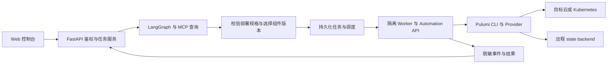

# IaC 选型记录：Pulumi 与 Terraform

选型日期：2026-09-08；状态更新：2026-09-09。结论：本项目的目标 IaC 引擎改为 **Pulumi，使用 Python + Automation API，由独立 Worker 执行**。本机 CLI / SDK 已完成基础安装验证；生产 state backend 尚未选定，业务 Worker 和真实部署能力仍未接入。

本文记录选型依据、取舍和后续验证范围；后端开发及执行约定的唯一来源仍是 [README](../README.md#agent-与-pulumi-执行规范)，实际进度见 [todo](../todo.md)。比较基于本次核对的官方资料；“更适合”“成本更低”等结论是结合本项目作出的工程判断，不是通用性能结论。

## 为什么本项目主选 Pulumi

当前仓库采用 FastAPI、Pydantic 和 Python，计划用 LangGraph 理解需求、MCP 查询环境，并通过 Web 控制台组织持续运行的部署任务。仓库尚无 Terraform 配置、模块、state 或部署 Worker，因此此次调整不涉及既有资源迁移。公司其他系统是否已有大量 Terraform 资产，需要在接入真实环境前另行盘点。

这个平台需要把“创建一个应用环境”“调整应用容量”等动作封装成后端业务能力。Pulumi 的 Python Automation API 提供 stack 生命周期操作、结果和事件回调，适合放入任务执行适配层；ComponentResource 则适合封装组织内可复用的资源组合。这与现有 Python 开发方式相符。[Automation API](https://www.pulumi.com/docs/iac/concepts/automation-api/)、[Components](https://www.pulumi.com/docs/iac/concepts/components/)

选型依据主要是平台集成与组件开发效率。Terraform 同样能够用于内部平台，也可以自动化、测试和扩展；内部使用许可本身不构成本项目必须切换的理由。

## 从开发与运维角度比较

| 维度 | Terraform | Pulumi | 对本项目的影响 |
|---|---|---|---|
| 资源表达与复用 | 以 HCL 声明资源，用 module 组织复用 | 可用 Python 等语言声明资源，用组件及语言包组织复用 | Python 组件便于复用类型、校验、测试与内部 SDK；需要控制抽象复杂度 |
| 嵌入后台任务 | CLI、机器可读 JSON；HCP Terraform / Enterprise 另提供运行 API | Automation API 将 preview、up、refresh、destroy 等封装为语言 SDK，仍依赖 CLI | Pulumi 更贴近 Python service/Worker 的接口形态，减少自建命令适配代码 |
| 变更审核 | 保存 plan 后交给 apply，审核产物与执行输入关系直接 | preview 后 up；可保存 update plan，但计划约束在执行过程中逐步校验 | Terraform 更适合已经围绕 saved plan 建立的流程；Pulumi 需明确版本绑定和偏差处理 |
| 资源与组件生态 | Registry 的 providers、modules 可直接用于 HCL 项目 | 有 Pulumi providers，也能桥接 Terraform/OpenTofu provider 并生成 SDK | 按目标资源的字段、导入、更新、替换和删除行为验收，不能只数 provider 数量 |
| 测试与开发工具 | 原生 terraform test、断言、provider mock | 可使用 Python 测试框架、资源 mock 和真实环境集成测试 | 两者都能测试；Pulumi 方便沿用当前 Python 工具，mock 都不能证明云端部署正确 |
| 状态与协作 | remote backend，是否支持锁取决于具体 backend；HCP/TFE 提供托管能力 | Pulumi Cloud 或 DIY backend；DIY 已有锁和 checkpoint history | 两者都需要明确隔离、并发、备份、恢复和权限；不能依赖 Worker 本地 state |
| 平台治理与成本 | 可自建执行与策略流程，也可使用 HCP/TFE 的平台功能 | 可自建 Worker/DIY backend/本地策略，也可选商业 Pulumi Cloud | 引擎许可、托管服务和自建运维成本分别核算，不能把产品宣传中的整个平台视为开源自带 |
| 团队与已有资产 | 熟悉 HCL、已有稳定 modules/state 的运维团队更容易延续现有流程 | Python 开发团队构建定制组件和平台 API 更顺手 | 本仓库从零开始适合 Pulumi；不建议仅为统一语言迁移其他系统的稳定生产资产 |

资源模型方面，两者都由引擎根据期望状态和依赖图计算变更。Pulumi 使用 Python 不意味着按代码行顺序直接创建资源；开发者仍需理解 Input/Output、未知值、资源身份及依赖传播。避免把 Pulumi 程序当作普通云 SDK 脚本。[Terraform language](https://developer.hashicorp.com/terraform/language)、[Pulumi Inputs & Outputs](https://www.pulumi.com/docs/iac/concepts/inputs-outputs/)

Terraform 官方支持 `init → plan -out → show -json → apply <plan>` 自动化路径；采用 HCP/TFE 时也可通过 API 创建运行。Pulumi 的优势是开源 Automation API 的编程接口，而不是“Terraform 无法接 API”。两者最终都要管理执行环境、凭据、超时和任务恢复。[Terraform automation](https://developer.hashicorp.com/terraform/tutorials/automation/automate-terraform)、[HCP API workflow](https://developer.hashicorp.com/terraform/cloud-docs/workspaces/run/api)

Pulumi 的 Any Terraform Provider 能降低接入已有 provider 的成本，包括内部 provider；桥接层与底层 provider 仍需分别锁定、测试。已有 Terraform module 和 state 不能因为 provider 可复用就视为已经转换；未来如需迁移，按资源建立导入和归属切换方案，避免两个引擎同时管理同一资源。[Terraform providers](https://developer.hashicorp.com/terraform/language/providers)、[Terraform modules](https://developer.hashicorp.com/terraform/registry/modules/use)、[Pulumi Any Terraform Provider](https://www.pulumi.com/docs/iac/concepts/providers/any-terraform-provider/)

测试应分为输入/组件单测、引擎集成、真实目标环境验证。两者都有原生测试支持；Pulumi 的 Python 复用优势不应被表述为 Terraform 缺少测试能力。[Terraform tests](https://developer.hashicorp.com/terraform/language/tests)、[Pulumi testing](https://www.pulumi.com/docs/iac/concepts/testing/)

## 影响平台设计的关键差异

### 预览、审核与实际执行

Terraform 的保存计划包含随后 apply 使用的计划数据，适合作为审核工件。Pulumi `preview --save-plan` / `up --plan` 会再次运行程序，随输入解析逐步检查资源操作是否满足计划约束；发现偏差前，可能已经执行部分符合计划的操作。未知输入、在 Output.apply 回调中创建资源、使用未知值配置 provider 均需专项验证。官方将计划 JSON 格式标为实验性，平台不应直接依赖该内部格式。[Terraform plan](https://developer.hashicorp.com/terraform/cli/commands/plan)、[Pulumi update plans](https://www.pulumi.com/docs/iac/operations/stack-management/update-plans/)

因此，平台应把审核关联到不可变的规格、程序/组件、依赖、配置版本、目标 stack 和预览结果，执行前检查状态及绑定是否变化，变化后重新预览并按环境策略处理授权。保存 Pulumi update plan 可以增加约束，但不能代替这些业务检查。严格要求“审核后执行完全确定的保存计划”的环境，应先验证 Pulumi 能否满足其具体标准，再开放执行。

两者都不提供跨云资源的事务回滚。失败后可能保留部分已完成变更；恢复必须结合最新 state 和实际资源，不能把重试、回滚代码或 destroy 当作自动恢复方案。[Terraform apply](https://developer.hashicorp.com/terraform/cli/commands/apply)

### State backend 与平台控制面

Pulumi Cloud 不是使用 Pulumi 或 Automation API 的必选项。自行管理的 DIY backend 已提供状态锁和历史；选择对象存储时，平台负责访问控制、备份恢复、可用性及故障演练。存储层权限不能直接表达“允许更新但禁止删除”等业务动作，仍需要平台鉴权和受控 Worker。Pulumi Cloud 则提供额外的事务状态服务及团队治理能力。[Pulumi state](https://www.pulumi.com/docs/iac/concepts/state-and-backends/)、[DIY backend](https://www.pulumi.com/docs/iac/operations/stack-management/using-a-diy-backend/)

本项目建议把状态后端作为单独决策：有明确内网、自主运维要求时，优先验证内部可用的远程 DIY backend 与 KMS 等 secrets provider；希望减少状态服务和团队治理维护时，再比较 Pulumi Cloud 的托管或商业自托管方案。自托管 Pulumi Cloud 与使用自己的对象存储作为 DIY backend 是两种不同选择。[Cloud vs OSS](https://www.pulumi.com/docs/iac/guides/basics/pulumi-cloud-vs-oss/)、[Self-hosted Pulumi Cloud](https://www.pulumi.com/product/self-hosted/)

PostgreSQL 中的用户、任务、审批、事件，与 IaC 引擎维护的 state 是不同职责；即便未来所选 backend 也使用数据库，也不应由业务代码直接修改引擎内部状态。稳定 stack 负责长期资源归属，一次 task 只代表一次运行；调度器按 stack 串行写入，同时依赖 backend lock 防止执行冲突。

### Secret 与执行隔离

Pulumi 对标记为 secret 的值及其派生值加密，普通 state 字段仍可为明文；程序执行时也可能拿到 secret 明文。Python Automation API 的部分结果选项允许包含 secrets，应显式关闭相应选项，并只保存和返回经过筛选、脱敏的事件字段。平台 API 不直接暴露完整 SDK 结果或原始 state。[Pulumi secrets](https://www.pulumi.com/docs/iac/concepts/secrets/)、[Python Stack.up](https://www.pulumi.com/docs/reference/pkg/python/pulumi/#pulumi.automation.Stack.up)

对本项目而言，Agent 适合生成经过校验的部署规格，受控组件负责解释规格并声明资源。Python 程序在 preview 时也会运行，因此新组件和依赖必须经过发布流程，Worker 与 API 进程隔离。这个成本应计入 Pulumi 的开发便利性，而不是把通用编程能力当成无约束执行能力。

## 许可与总成本

Pulumi IaC 核心仓库采用 Apache 2.0；Pulumi Cloud 的商业服务和自托管版本单独评估。Terraform 当前核心许可证为 BSL 1.1，其条款明确区分组织内部使用与向第三方提供竞争性产品。对本次讨论的纯内部平台，不能据此推导“Terraform 必须付费”；若未来转为外部商业产品，则需重新核对当时版本、用途和许可条款。[Pulumi LICENSE](https://github.com/pulumi/pulumi/blob/master/LICENSE)、[Terraform LICENSE](https://github.com/hashicorp/terraform/blob/main/LICENSE)、[HashiCorp licensing FAQ](https://www.hashicorp.com/en/license-faq)

成本比较应包含平台开发、组件维护、执行资源、状态存储、密钥、备份恢复和团队支持；采购托管产品时，再按实际资源量、用户规模和所需功能核算。当前没有规模和采购需求，不给出虚构的月费或“完全免费”的结论。选择 Pulumi 的主要理由是本项目的工程适配，许可宽松是附加因素。

## 建议的接入方式与验收

建议按以下职责组织，具体接口、表结构及事件协议在接入时设计：

业务服务控制身份、环境权限、规格版本、审核和任务生命周期；Worker 执行 Pulumi 操作并上报结果。LangGraph checkpoint、业务任务与 Pulumi state 独立持久化，前端通过平台事件恢复进度。首版先接一套受控组件和一种目标，不同时建设多引擎执行系统。

开始接入前，需要确认首个应用类型、目标环境、云/Kubernetes 凭据、state backend、secrets provider 和组件责任人。Pulumi 的 Python 文档明确支持 uv，但当前 CPython 3.14 与所选 SDK、插件及传递依赖的完整组合仍需在最终 Worker 镜像中实测，随后锁定版本。[Pulumi Python](https://www.pulumi.com/docs/iac/languages-sdks/python/)

| 验证阶段 | 完成证据 |
|---|---|
| 运行时与资源覆盖 | 在目标 Worker 镜像完成依赖安装；验证关键资源属性、导入、更新、替换及删除行为 |
| 最小真实闭环 | 在授权测试环境执行 preview → up → 健康检查 → refresh；重复执行无意外变更，并完成测试资源清理 |
| 审核与并发 | 规格/程序/配置/状态变化使旧审核失效；同 stack 并发被协调；验证计划偏差和未知值处理 |
| 故障恢复 | 模拟进程中断、超时、网络失败和部分更新后，能识别实际结果并恢复；取消不会被报告为回滚成功 |
| 数据与凭据 | 任务/事件可恢复，状态可从备份恢复，日志/事件/产物不泄露测试密钥，权限按环境隔离 |
| 前后端联调 | 只展示真实任务、资源差异和服务端确认结果；重连可继续查看任务，health 成功不会提前开启部署 |

这些是后续验收条件。2026-09-08 仅完成选型和文档调整；2026-09-09 已安装本机 Pulumi CLI / SDK 3.261.0，并在 CPython 3.14.7 上完成常量输出程序的本地基础验证，临时 stack/state 已清理。未使用目标 Provider 或云资源，详细结果见 [todo](../todo.md#pulumi-基础安装验证2026-09-09)。
