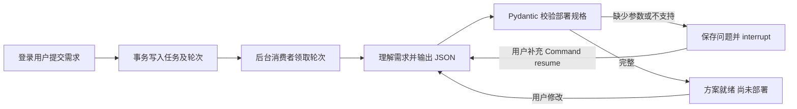

# LangGraph 需求分析与持久会话

本轮实现将用户需求变为可校验的 Kubernetes Redis/PostgreSQL 部署方案。LangGraph 编排状态与追问，PostgreSQL 保留队列和会话；真实集群查询和资源执行仍待接入。后续按 [Redis 开发计划](redis-development-plan.md) 在固定参数发布完成后接自然语言，Pulumi 业务接入暂停。后端规范以 [README](../README.md) 为准。

## 工作流

模型使用服务端指定的 OpenAI 兼容 Chat Completions 接口，API 不接受 endpoint、model、key 或代码。默认 JSON mode，提供 schema 给模型，响应仍须本地 Pydantic 校验；兼容网关支持时可配置 strict JSON schema。未配置模型或 key 时返回 `11001`，不会用规则解析或固定答案冒充模型推理。

结构化方案包括 `target=kubernetes`、`cluster`、`namespace`，以及最多 8 个服务的 `kind/name/version/storage_gi/replicas`。kind 只允许 redis/postgresql，replicas 固定为 1；未指定服务名时使用 kind。集群、命名空间、版本和存储容量不可猜测，缺失时追问；重名也需追问。容量为 1–1024 Gi，名称遵守 DNS label 格式，版本只接受数字开头的版本标签。多副本、外网访问和其他组件目前要求调整需求，不能静默降级。模型抽取仍可能误解语义，用户应核对方案；这些标签不是经过核实的库存、可用版本、容量或镜像 digest。

## 持久化与并发

- `agent_tasks` 保存所有者及对外快照，`agent_turns` 保存每轮请求、队列状态及 trace_id。API 事务提交后即返回 `queued`，不会等待模型。
- 每个应用进程启动一个异步消费者。PostgreSQL `FOR UPDATE SKIP LOCKED` 独占轮次行直到图运行和业务结果提交；同一任务最多一个 queued 轮次。整个模型调用最多 45 秒、轮次最多 90 秒（可配置）。事务会占用一个数据库连接，适用于当前有限吞吐量；更高吞吐量应迁移独立执行进程并设计租约，不能简单缩短行锁范围。
- 提交先锁用户行，再检查最多 5 个 queued 任务；每个会话最多 20 轮，每次需求最多 4000 字符。轮次序号与任务 revision 同步递增，轮次唯一约束避免重复。
- 官方 `AsyncPostgresSaver` 使用独立 psycopg pool 与 `agent_graph` schema，autocommit、dict_row；`init-agent` 显式迁移，应用和请求不自动建表。Alembic 只管理 public 中的业务表。
- checkpoint 仅保存普通 JSON 数据，并限制反序列化类型，关闭 pickle fallback。调用使用 `durability="sync"`；图保存分析进度，业务表保存用户任务。后续 Git 配置修订与部署结果按开发计划独立管理。
- 消费进程取消/退出时事务回滚，轮次继续保持 queued，下个消费者可重新领取。checkpoint 中保存 turn_id：如果图已完成但业务提交未完成，重领直接回收结果；如果节点未完成，恢复 pending 节点；尚未写下 checkpoint 的模型请求可能再次调用，可能重复计费，不能承诺外部调用恰好一次。
- `interrupt()` 节点只等待补充参数，没有模型调用或资源副作用。继续输入使用同一 thread 的 `Command(resume=...)`。HTTP 层不开放 checkpoint_id、thread_id override、任意 Command 或图状态写入。
- 模型超时、HTTP 错误、拒绝、截断及无效 JSON 均标记 failed，返回固定安全提示。失败重试复用原轮次，不追加消息或增加 revision；只有 needs_input/ready 可以提交新一轮。

`queued` 表示等待或分析中，`needs_input` 表示等待补充，`ready` 表示生成方案，`failed` 表示本轮分析失败。客户端轮询业务快照，断开不会取消已提交任务。当前不提供取消、删除、审核或部署接口。

## API 契约

全部要求有效 Bearer 登录态，采用 README 统一响应，响应 `Cache-Control: no-store`；查询其他用户任务返回 403，不存在返回 404。GET 列表最近 50 条、按 update_at 降序。所有携带参数的操作使用 POST。

| 方法 | 路径（前缀 `/api/v1/agent`） | 请求 / 返回 |
|---|---|---|
| GET | `/status` | `{configured,message}`；仅表示配置齐全，不表示网关或集群连通 |
| GET | `/tasks` | `{items: TaskSummary[]}` |
| POST | `/tasks/create` | `{request_id: UUID,message}` → TaskDetail；task_id 与首次 request_id 相同 |
| POST | `/tasks/detail` | `{task_id: UUID}` → TaskDetail |
| POST | `/tasks/message` | `{task_id,request_id,expected_revision,message}` → TaskDetail |
| POST | `/tasks/retry` | `{task_id,expected_revision}` → TaskDetail |

TaskSummary：`task_id,title,status,revision,create_at,update_at`。TaskDetail 增加 `messages:[{role:user|assistant,content}]`、`spec:DeploymentSpec|null`、`questions:string[]`、`error:string|null`。UTC 时间以 ISO 8601 输出。规范由 `app/schemas/agent.py` 和实际 `/openapi.json` 给出。

创建和发送的 request_id 由客户端生成并在网络重试时复用。同 key 同内容返回任务当前快照，同 key 异内容拒绝；幂等检查先于 revision 检查，重复请求不会添加新轮次。retry 不增加 revision；重复 retry 在 queued 时返回忙，在已完成时返回状态冲突。

| 业务码（HTTP 200） | 意义 |
|---|---|
| 11001 | 模型未配置 |
| 11002 | 任务正在等待或分析 |
| 11003 | revision 或当前状态不允许该操作 |
| 11004 | 排队任务数或会话轮数上限 |
| 11005 | request_id 已用于不同请求 |

## 运行与数据边界

依赖由 uv.lock 锁定：本轮 LangGraph 1.2.11、PostgreSQL checkpointer 3.1.2、OpenAI SDK 2.54.0；SQLite checkpointer 仅作测试。CPython 3.14 的异步运行验证结果见 todo。

key 仅从私有 `OLIXOPS_AGENT_API_KEY` 注入，不能发给前端。网关地址配置包含 `/v1` 等前缀，不含 `/chat/completions`、查询参数或内嵌密码；修改网关会改变需求文本的接收方，按内部部署配置管理。请求传递平台 trace_id，不透传用户 JWT/Cookie；SDK 禁用自动重试，关闭 SDK debug 正文日志和本工作流的外部 LangSmith tracing。

用户对话文本、规格、业务快照与 checkpoint 都属于持久业务数据，不要在需求中提交密码、连接串或 kubeconfig。数据库备份/访问控制需要同时覆盖 public 业务表和 agent_graph schema；按用户删除业务表记录不会自动清理独立 checkpoints，后续数据保留/删除功能需统一实现。

运行步骤及环境变量见 README。`uv run python -m app.cli init-agent` 可重复执行，迁移过程用 PostgreSQL advisory lock 串行；不需要 Pulumi 登录或 Kubernetes 凭据。后续模型规格经校验后进入版本化模板、配置差异确认及固定 Git 修订的发布链路，不能直接执行模型输出。

## 官方依据

- [LangGraph persistence](https://docs.langchain.com/oss/python/langgraph/persistence)
- [LangGraph interrupts](https://docs.langchain.com/oss/python/langgraph/interrupts)
- [LangGraph durable execution](https://docs.langchain.com/oss/python/langgraph/durable-execution)
- [AsyncPostgresSaver](https://reference.langchain.com/python/langgraph/checkpoints/#langgraph.checkpoint.postgres.aio.AsyncPostgresSaver)
- [OpenAI Structured Outputs](https://developers.openai.com/api/docs/guides/structured-outputs)
